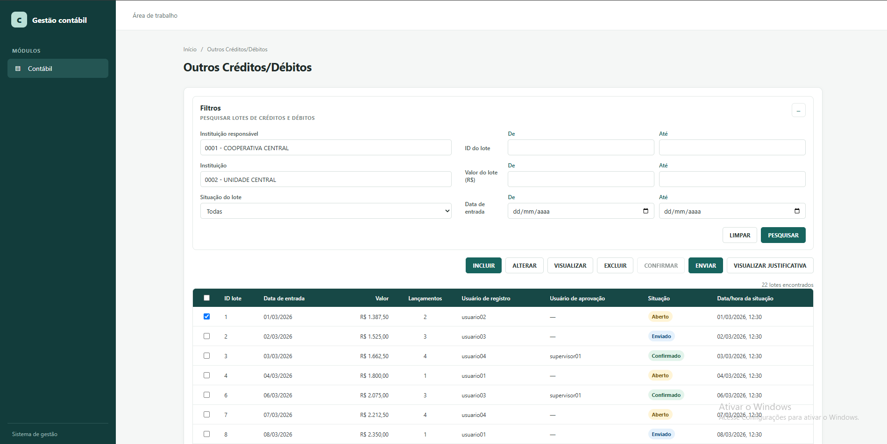
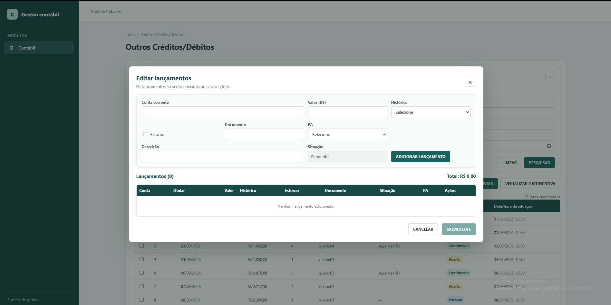

# Accounting Module

Aplicação web desenvolvida em Angular para consulta e gerenciamento de lotes de outros créditos e débitos de um módulo contábil.

O projeto conta com uma API mock desenvolvida para o runtime Bun, permitindo a execução local da aplicação sem depender de um backend externo.

## Tecnologias

- Angular 21.2
- Angular CLI 21.2.31
- TypeScript
- RxJS
- Bun 1.4.5 — servidor mock
- Vitest — testes unitários

## Funcionalidades

- Consulta de lotes com filtros por instituição, situação, identificador, valor e data de entrada.
- Listagem de lotes e informações de registro e aprovação.
- Interface para inclusão, alteração e visualização de lotes e lançamentos.
- Ações de exclusão, confirmação, envio e visualização de justificativas.

## Demonstração

### Consulta de lotes

)

### Edição de lançamentos



## Pré-requisitos

- Node.js em uma versão compatível com o Angular 21 (por exemplo, Node.js 22.12.0 ou superior da linha 22).
- npm.
- [Bun](https://bun.sh/docs/installation) (versão de referência: 1.4.5).
- Git.

O Bun deve estar instalado antes de iniciar a API mock. A dependência `@types/bun` fornece apenas as definições de tipos para o TypeScript, não o runtime.

Verifique as versões instaladas:

```bash
node --version
npm --version
bun --version
```

## Execução local

### 1. Instalar as dependências

Após clonar o repositório, acesse a raiz do projeto e execute:

```bash
npm ci
```

### 2. Iniciar a API mock

Em um terminal, na raiz do projeto:

```bash
npm run mock
```

A API mock é executada na porta `3333`, utilizando o Bun em modo de observação de alterações (`--watch`).

### 3. Iniciar o frontend

Em um segundo terminal, também na raiz do projeto:

```bash
npm start
```

Acesse [http://localhost:4200/](http://localhost:4200/).

Mantenha os dois terminais em execução durante a utilização da aplicação.

## Comunicação com a API mock

O servidor mock está disponível no mesmo repositório do frontend, com ponto de entrada em `server/index.ts`.

O servidor de desenvolvimento do Angular utiliza um proxy para encaminhar as requisições com prefixo `/api` para a API local na porta `3333`.

| Serviço          | Endereço local          |
| ---------------- | ----------------------- |
| Frontend Angular | `http://localhost:4200` |
| API mock         | `http://localhost:3333` |

A API mock simula o backend para fins de desenvolvimento e avaliação técnica, não sendo destinada a ambientes de produção.

## Testes unitários

Para executar os testes com Vitest:

```bash
npm test
```

Para executar os testes uma única vez:

```bash
npm test -- --watch=false
```

## Build

Para gerar o build da aplicação:

```bash
npm run build
```

Os artefatos compilados serão disponibilizados no diretório `dist/`. O build não inclui a execução do servidor mock.

## Fluxo de desenvolvimento

O projeto adota um GitFlow simplificado:

- `main`: versão estável do projeto.
- `develop`: integração das funcionalidades.
- `feature/*`: desenvolvimento de funcionalidades e melhorias.
